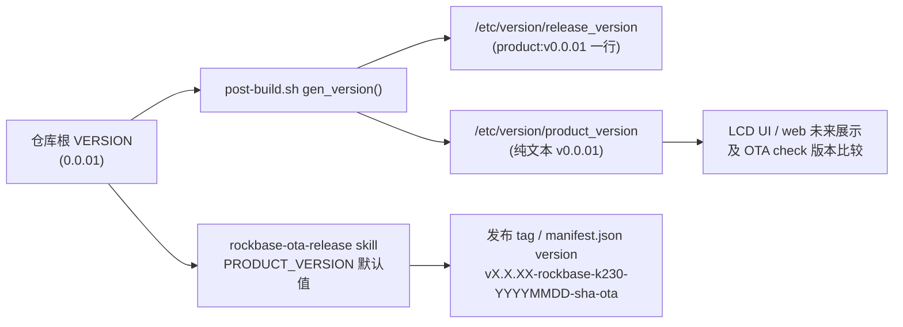

# Rockbase 产品可读版本号

面向人类可读的产品版本号，和 SDK 编译时间戳（`sdk:` 那行）是两回事，互不覆盖。

## 唯一真源

仓库根目录的 `VERSION` 文件，纯文本一行，**不带 `v` 前缀**，格式 `MAJOR.MINOR.PATCH`：

```
0.0.01
```

- **PATCH 始终两位数字**（不足补零）：`0.0.01`、`0.0.02`、`0.0.10`，不写 `0.0.1`。
  MAJOR 和 MINOR 不补零（当前阶段都是个位数，若将来超过 9 则自然扩展）。
- 展示 / 打 tag 时统一在前面加 `v`，例如 `v0.0.01`。
- **当前版本以仓库根 `VERSION` 文件实际内容为准**，本文件不硬编码版本号；
  上面 `0.0.01` 仅为格式示例。
- **2026-09-05 版本线重置**：此前所有已发布的 OTA release（`vx.x.xx`、`v0.1.0`、
  `v0.1.1`、`v0.2.0` 等）及其 tag 已全部删除，版本号从 `v0.0.01` 重新开始。
  这些旧版本号作废，不要复用、不要在其基础上递增。
- 与仓库里 `v0.1.0`、`v1.3` 这两个历史 tag 无关——那是上游 Canaan K230 SDK 遗留的 tag，
  不是 Rockbase 产品版本，不要混用、不要在这两个基础上继续递增。

## 版本号含义（参照 Semantic Versioning 2.0.0，semver.org，按固件场景收窄）

`MAJOR.MINOR.PATCH`：

- **MAJOR**：不兼容变更。出现以下任一情况才加：
  - OTA 格式/签名方案变更，旧版本设备无法直接升级到这次的包
  - 分区布局变更，需要重新烧录而不是 OTA
  - Web/status API 破坏性变更导致旧前端读不出关键字段
  - 首次对外公开发布（从内测/内部试用转为面向外部用户的正式发布，如 `0.x` → `1.0`）
  - 加了 MAJOR 之后，MINOR 和 PATCH 都归零（PATCH 归零即 `00`）。
- **MINOR**：新增向后兼容的功能。例如新页面、新监控指标、新的 OTA 子命令、
  新的 web 接口字段（旧字段不删不改）。加了 MINOR 之后 PATCH 归零（即 `00`）。
- **PATCH**：向后兼容的修复/小改动。文案修正、UI 卡片调整、bug fix、性能调优、
  依赖版本号小改，且不引入新功能、不破坏兼容性。
  PATCH 范围 `00`–`99`；达到 `99` 后下一次升版进位到 MINOR（`0.2.99` → `0.3.00`），
  不出现三位 PATCH。

不使用 semver 的预发布/构建元数据后缀（如 `-rc1`、`+build.5`）：保持
`MAJOR.MINOR.PATCH` 三段纯数字，方便 shell（`rockbase-ota.sh` 等 busybox 环境）
按数值而不是字符串比较版本大小。

## 版本比较规则（写 OTA 检查逻辑时必须遵守）

禁止直接按字符串比较版本号（`"0.0.9" > "0.0.10"` 这种字符串比较会得到错误结果）。
必须拆成三段分别按数值比较。PATCH 始终两位（`00`–`99`），数值比较时 `00` 和 `0` 等价，
所以一位/两位 PATCH 混在一起（如 `v0.1.1` vs `v0.0.01`）也能安全比较：

```sh
# version_gt a b: a 是否比 b 新（busybox ash 兼容，用参数展开而非 IFS read）
# 实际实现见 rockbase-ota.sh 的 version_gt()
version_gt() {
    local a=${1#v} b=${2#v}
    local a_maj a_min a_pat b_maj b_min b_pat
    a_maj=${a%%.*}; a=${a#*.}; a_min=${a%%.*}; a_pat=${a#*.}
    b_maj=${b%%.*}; b=${b#*.}; b_min=${b%%.*}; b_pat=${b#*.}
    case "$a_maj" in ''|*[!0-9]*) a_maj=0 ;; esac
    case "$a_min" in ''|*[!0-9]*) a_min=0 ;; esac
    case "$a_pat" in ''|*[!0-9]*) a_pat=0 ;; esac
    case "$b_maj" in ''|*[!0-9]*) b_maj=0 ;; esac
    case "$b_min" in ''|*[!0-9]*) b_min=0 ;; esac
    case "$b_pat" in ''|*[!0-9]*) b_pat=0 ;; esac
    [ "$a_maj" -gt "$b_maj" ] && return 0
    [ "$a_maj" -lt "$b_maj" ] && return 1
    [ "$a_min" -gt "$b_min" ] && return 0
    [ "$a_min" -lt "$b_min" ] && return 1
    [ "$a_pat" -gt "$b_pat" ]
}
```

## 版本号在系统里的流转



- **编译期**：`buildroot-overlay/board/canaan/k230_rockbase/post-build.sh` 的
  `gen_version()` 读取仓库根 `VERSION`，写入两处：
  - `/etc/version/release_version` 里追加一行 `product:v<VERSION>`（跟 `sdk:` 那行放一起，方便一次性核对）
  - `/etc/version/product_version`：只有一行 `v<VERSION>`，专门给需要"干净版本号"的读取方（LCD、web、OTA 脚本）用，不用再解析多行 banner。
- **发布期**：`rockbase-ota-release` skill 生成 `VERSION`（发布用的环境变量，和本文件同名但含义是"这次发布用的版本串"）时，默认从仓库根 `VERSION` 文件读取 `PRODUCT_VERSION`，不再用占位符 `vx.x.xx`。
- **设备侧未来使用**（LCD Check Update 按钮等）：读 `/etc/version/product_version` 作为"当前安装版本"，与 manifest.json 里的 `version` 字段比较，按上面的数值比较规则判断是否有更新。

## 升版流程

1. 确认这次改动量级属于 MAJOR / MINOR / PATCH（按上面的定义判断，拿不准就走 PATCH，
   不要为了"看起来正式"就跳级）。
2. 编辑仓库根 `VERSION` 文件，写入新版本号（纯数字，不带 `v`，**PATCH 两位**）。
3. 单独提交，commit message 里说明升版原因，例如：
   `chore(version): bump to 0.0.02 (fix system page load-avg card removal)`。
4. **在升版 commit 上打 git tag**：`git tag v<VERSION>`（如 `git tag v0.0.02`）。
   tag 名带 `v` 前缀，与 `VERSION` 文件内容一一对应；tag 必须指向升版 commit
   （即包含 `VERSION` 文件改动的那个 commit），不要打在功能 commit 上。
   有远端时一并推送：`git push origin v<VERSION>`。
5. 版本号只能递增，不能回退；同一个版本号已经发布过 OTA release 后不能复用
   （见 `rockbase-ota-release` skill 里"同一 vX.X.XX+board+date+sha 只能发布一次"的规则）。
   已发布版本发现 bug：PATCH +1 发修复版（如 `0.0.01` 有 bug → 发 `0.0.02`），
   不要试图覆盖或撤回已发布 release。
6. 需要发布 OTA 时，先确认 `VERSION` 已经按第 1-4 步更新完（含 tag），再走
   `rockbase-build` → `rockbase-ota-release` → `rockbase-ota` 三步链路。

## 常见错误

- 不要把仓库根 `VERSION` 文件和 `/etc/version/release_version` 里的 `sdk:` 那行
  混为一谈——后者是编译时间戳+commit，每次编译都变，不代表产品版本号。
- 不要用字符串比较版本号（`0.0.9` vs `0.0.10`，字符串比较会错误地认为 `0.0.9` 更大）。
- 不要把 PATCH 写成一位（`0.0.1`）——必须两位（`0.0.01`），保持 tag 格式统一为
  `vX.X.XX`。
- 不要跳过 `VERSION` 文件直接在发布脚本里手写版本号——`rockbase-ota-release`
  的默认值必须来自这个文件，手写等于绕过唯一真源。
- 升版后忘记打 git tag——每次升版 commit 后必须 `git tag v<VERSION>` 并推送，
  否则后续无法从 tag 追溯该版本的完整源码状态。
