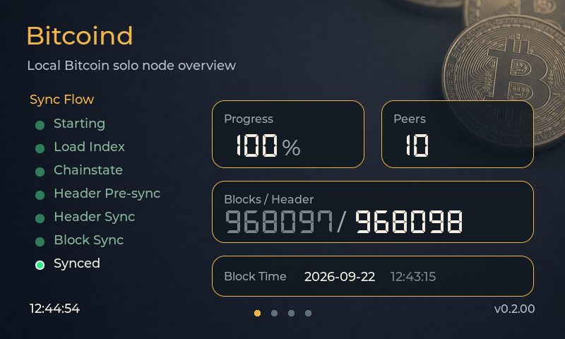
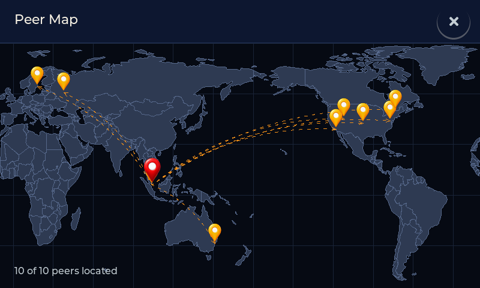

# Rockbase — K230 Bitcoin Solo Mining Node

> **Language: English** | [中文](README_zh.md)

> A **Bitcoin pruned validating node + local Stratum / solo mining device** built on the Kendryte K230 (RISC-V). Boots from a single SD card, with a built-in 800×480 touch LCD, a web monitoring UI, and A/B slot OTA upgrades.

---

## Table of Contents

- [What It Is](#what-it-is)
- [What It Can Do](#what-it-can-do)
- [What It Cannot Do](#what-it-cannot-do)
- [Hardware & Runtime Components](#hardware--runtime-components)
- [Building](#building)
- [Flashing](#flashing)
- [LCD UI](#lcd-ui)
- [Developer Workflow](#developer-workflow)
- [Repository Layout](#repository-layout)
- [Reference Docs](#reference-docs)

---

## What It Is

Rockbase is a small hardware device for individual miners:

- **Bitcoin Core v31.1** (pruned mode, `prune=4096`) downloads and validates blocks;
- **ckpool** serves a local Stratum v1/v2 interface — miners connect directly to the board;
- **rockbase-lcdui** (LVGL) drives the 800×480 touch panel: sync progress, hashrate, peer map, etc.;
- **rockbase-webd** serves a web dashboard and status API at `http://<board-ip>/`;
- **A/B slot OTA**: U-Boot manages two rootfs slots; OTA writes the inactive slot and rolls back automatically on failure.

## What It Can Do

The core of Rockbase is a **standalone Bitcoin node you can mine against**:

- **Validates the Bitcoin chain on its own** — full header + block validation, pruned storage
  (`prune=4096`, keeps the most recent ~4 GB of blocks). No external node required.
- **Solo mining out of the box** — built-in ckpool Stratum v1/v2 service; point your miner at
  `stratum+tcp://<board-ip>:3333` and mine directly against your own node.
- **Fast cold start (optional)** — a "full image" ships with pre-seeded block data, skipping
  most of the initial chain download.

## What It Cannot Do

Explicit capability boundaries of the node:

- **Not a full node**: `prune=4096` keeps only the most recent ~4 GB of blocks. It cannot serve
  full historical blocks/UTXOs to other nodes, and RPCs requiring full chain data
  (all `getblockfilter`, long-range `scantxoutset`, …) are not supported.
- **Not a mining pool**: ckpool targets solo / small-team use. No multi-user account system,
  no PPLNS-style reward schemes — not suitable for running a public pool.
- **No wallet**: bitcoind runs in server mode; it is not a user-facing wallet.
- **Not a hashrate source**: the K230 is a RISC-V application processor — CPU mining efficiency
  is very low. The device's value is **validation + a local Stratum endpoint**, not mining power.
- **IPv4 only, limited peers**: `onlynet=ipv4`, `maxconnections=10` (no inbound behind NAT);
  cold-start sync speed is bounded by uplink bandwidth and peer quality.

## Hardware & Runtime Components

| Item | Spec |
|------|------|
| SoC | Kendryte K230 (dual-core C908 + dual-core C906, RISC-V) |
| Memory | 1 GB or 2 GB LPDDR4 (probed at runtime by U-Boot; one image fits both) |
| Display | 800×480 touch LCD (DSI; framebuffer 480×800 ARGB8888 portrait, rotated for rendering) |
| Storage | SD card (mmc1; A/B dual rootfs slots + config + blockdata partitions) |
| Network | SDIO WiFi (RTL8189FS, mmc0) + USB NIC (one selected at runtime) |
| Boot | U-Boot → Linux (Buildroot rootfs) |

Key resident processes:

| Process | Role |
|---------|------|
| `bitcoind` | Bitcoin Core v31.1, datadir `/root/block` (blockdata partition) |
| `ckpool` | Local Stratum service |
| `rockbase-lcdui` | LVGL touch UI (peer map, OTA prompt) |
| `rockbase-webd` | Web dashboard + status API (`/root/web`) |
| `rockbase_status` | Status collector (feeds LCD/Web) |
| `rockbase_netsel.sh` | Network interface selection at boot |

## Building

### Prerequisites

- **Ubuntu 22.04 / 24.04** (WSL2 or bare metal; other versions may hit build issues)
- Disk: first full build needs roughly **60–80 GB** (toolchain + source tree + artifacts)
- RAM: ≥ 16 GB recommended (full-parallel builds)

### Install Toolchain

```bash
sudo make toolchain_and_depend
```

### Build the Image

The primary defconfig is `k230_rockbase_defconfig` (1G/2G merged into a single profile).

**Default: non-seed minimal image** (256 MB blockdata, ~5.2 GB image; syncs blocks after first boot):

```bash
mkdir -p /tmp/rockbase-empty-seed
make CONF=k230_rockbase_defconfig buildroot -j$(nproc) \
  BLOCK_SEED_DIR=/tmp/rockbase-empty-seed \
  K230_BLOCKDATA_SIZE=256M \
  K230_IMAGE_GZIP=0
```

**Full image (with seed)**: ships real block data (`K230_BLOCKDATA_SIZE=20G`),
skipping most of the initial download. The seed dir must contain `blocks/`, `blocks/index/`, `chainstate/`:

```bash
make CONF=k230_rockbase_defconfig buildroot -j$(nproc) \
  BLOCK_SEED_DIR=seed/root-block \
  K230_BLOCKDATA_SIZE=20G \
  K230_IMAGE_GZIP=0
```

### Artifacts

| Artifact | Path |
|----------|------|
| Flashable image | `output/k230_rockbase_defconfig/images/sysimage-sdcard.img` |
| WSL auto-export | `/mnt/d/code/pony/IoT/k230/img/sysimage-sdcard-rockbase-<stamp>/sysimage-sdcard.img` |

Image directory suffixes: `-min-` = non-seed minimal, `-full-` = seeded full image,
`-net-` = unified network image (both USB and SDIO drivers included).

### Incremental Build Gotchas

| Change type | Required before building |
|-------------|--------------------------|
| Add/modify `patches/linux/*.patch` | `make CONF=k230_rockbase_defconfig linux-dirclean` |
| **Content** edits under `rootfs_overlay/` or overlay top-level files | `make sync` (`.overlay_sync` is insensitive to content changes) |
| Local package sources (`package/<pkg>/src/`) | Nothing (rsync change detection is fixed; auto-rebuilds) |
| Suspected stale artifacts | `make CONF=k230_rockbase_defconfig clean` for a full rebuild |

## Flashing

The image is a raw whole-card image (includes the GPT table); write it to the whole card device:

**Linux / WSL:**

```bash
# After inserting the SD card, confirm the device node (the newly appeared /dev/sdX is the
# SD card — double-check, writing to the wrong device will destroy your disk)
ls -l /dev/sd*

sudo dd if=sysimage-sdcard.img of=/dev/sdc bs=1M oflag=sync
sync
```

**Windows:** use [Rufus](https://rufus.ie/downloads/), select `sysimage-sdcard.img`,
MBR partition scheme, and write.

After flashing, insert the SD card and power on. First boot:

1. U-Boot probes DDR size and boots slot A;
2. `rockbase_netsel.sh` selects the network interface based on attached hardware (USB NIC / SDIO WiFi);
3. `S59blockdata` mounts the blockdata partition at `/root/block`; bitcoind starts syncing;
4. The LCD shows a boot splash (~10 s) then the Bitcoind page; the web UI is available at `http://<board-ip>/`.

SSH login: `ssh root@<board-ip>` (passwordless root, LAN use only).

## LCD UI

The LCD is an 800×480 landscape touch UI; swipe left/right in the LVGL tileview to page through
**Bitcoind → Stratum → System → Network**.

### Bitcoind Page

Sync pipeline status (Starting → … → Synced), sync progress, current/latest block height,
latest block time. The top-right area is the **Peer Map entry** (tap to open the global peer distribution).



### Peer Map

Tap the top-right area of the Bitcoind page to open. All current peers are geolocated on a
world map via GeoIP; the red star marks this node, dashed lines show connection paths to each
peer; the footer shows how many peers were located (e.g. `10 of 10 peers located`).
Tap × in the top-right corner to close.



## Developer Workflow

### Hot-deploy First

For UI / business-logic changes, **hot-deploy to a real board first, then solidify into source**:

```bash
# Example: after changing the web frontend, scp it straight to the board to verify
scp buildroot-overlay/board/canaan/k230_rockbase/rootfs_overlay/root/web/app.js root@<board-ip>:/root/web/
```

### Closed-loop LCD Debugging

Two debug tools ship in the image (`/usr/bin/`):

- **`drmshot <out.ppm>`** — grabs the current screen from the DRM framebuffer (480×800 portrait PPM);
- **`touchswipe <x0> <y0> <x1> <y1> [steps]`** — injects touch events into `/dev/input/event0`
  (coordinates are ft5x06 physical panel coords 480×800, not UI landscape coords; tap = same start/end).

Typical loop: edit → build & deploy → swipe to the page → screenshot → visual check:

```bash
BOARD=192.168.124.9
# Swipe to the next page (physical Y decreasing = UI left = next page) and screenshot
ssh root@$BOARD '/usr/bin/touchswipe 240 700 240 100 10; sleep 2; /usr/bin/drmshot /tmp/screen.ppm'
scp root@$BOARD:/tmp/screen.ppm /tmp/screen_raw.ppm
python3 -c "
from PIL import Image
Image.open('/tmp/screen_raw.ppm').rotate(-90, expand=True).rotate(180).save('/tmp/screen.png')
"
```

Note: after a reboot wait ~12 s (touch is ignored during the boot splash); dismiss the OTA
prompt by tapping "Not Now".

### OTA Release Pipeline

`rockbase-build` (compile) → `rockbase-ota-release` (package, sign, publish to
`NMminer1024/btc-solo-node-release`) → `rockbase-ota` (apply on device).
Between the three steps, verify signing-key consistency (md5 of `~/.rockbase-ota-keys/ota-pub.pem`
must equal both `rootfs_overlay/etc/rockbase-ota-pub.pem` in source and
`/etc/rockbase-ota-pub.pem` on the device).

## Repository Layout

```
k230_linux_sdk/
├── Makefile                        # Top-level build entry (make CONF=... buildroot)
├── VERSION                         # Human-readable product version (vX.Y.ZZ)
├── buildroot-overlay/              # Buildroot overlay (core of this project)
│   ├── board/canaan/k230_rockbase/ # Rockbase board support
│   │   ├── rootfs_overlay/         # rootfs overlay (web/, etc/, scripts)
│   │   ├── patches/linux/          # Kernel patches (DTS, etc.)
│   │   ├── fragment/linux.fragment # Kernel config
│   │   ├── post-build.sh           # Seed validation, etc.
│   │   └── post-image.sh           # Image generation + export
│   ├── package/                    # Local packages (rockbase_lcdui, rockbase-geoip, ...)
│   └── configs/                    # defconfigs
├── docs/                           # Design docs, debug playbooks, screenshots (pic/)
├── seed/                           # Seed block data
├── tools/                          # Build helpers (sync.mk, etc.)
└── output/                         # Build artifacts (not committed)
```

## Reference Docs

| Doc | Content |
|-----|---------|
| `docs/rockbase-project-overview.md` | Project background, board baseline, build baseline |
| `docs/rockbase-debug-playbook.md` | Freeze/lockup debugging playbook |
| `docs/rockbase-freeze-milestones.md` | Freeze investigation milestones |
| `docs/rockbase-block-seed-image-workflow.md` | Seed image workflow |
| `docs/rockbase-ota-handoff.md` | OTA design and on-device verification log |
| `docs/rockbase-net-unified-image-plan.md` | Unified network image plan |
| `docs/rockbase-cpu-baseline.md` | CPU baseline data |
| `AGENTS.md` | Project memory (board list, core rules, skill index) |
