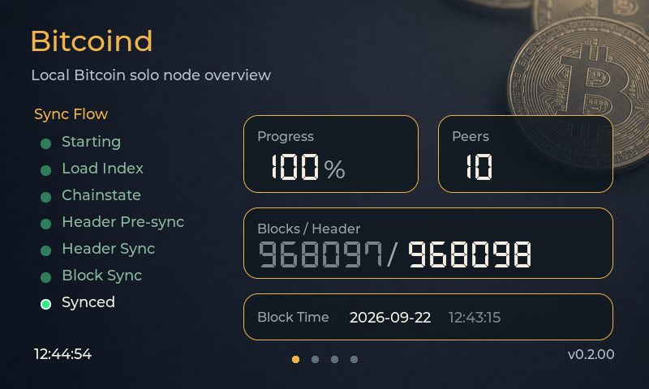
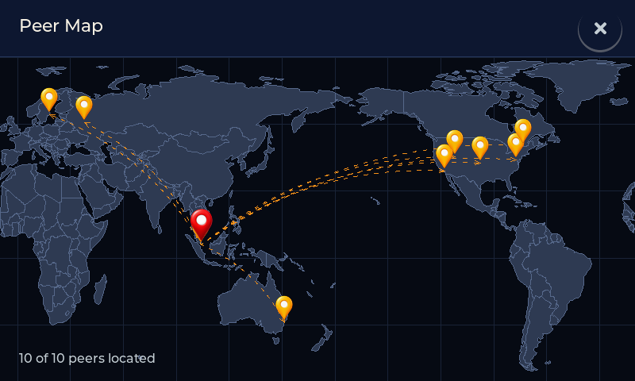

# Rockbase — K230 Bitcoin Solo 挖矿节点

> **语言：中文** | [English](README.md)

> 基于 Kendryte K230 (RISC-V) 的 **Bitcoin 剪枝验证节点 + 本地 Stratum / Solo 挖矿** 设备。
> 单块 SD 卡启动，内置 800×480 触摸 LCD、Web 监控界面与 A/B OTA 升级。

---

## 目录

- [项目是什么](#项目是什么)
- [能做什么](#能做什么)
- [不能做什么](#不能做什么)
- [硬件与运行组件](#硬件与运行组件)
- [构建](#构建)
- [烧录](#烧录)
- [LCD 界面](#lcd-界面)
- [开发者工作流](#开发者工作流)
- [仓库结构](#仓库结构)
- [参考文档](#参考文档)

---

## 项目是什么

Rockbase 是一台面向个人矿工的小型硬件设备：

- **Bitcoin Core v31.1**（pruned 模式，`prune=4096`）负责区块下载与验证；
- **ckpool** 提供本地 Stratum v1/v2 接口，矿机直连本机即可出块挖矿；
- **rockbase-lcdui**（LVGL）驱动 800×480 触摸屏，展示同步进度、算力、Peer Map 等；
- **rockbase-webd** 提供 Web 监控页面与状态 API（浏览器访问 `http://<board-ip>/`）；
- **A/B 双槽 OTA**：U-Boot 管理两个 rootfs 槽位，OTA 写对侧槽、失败自动回滚。

## 能做什么

Rockbase 的核心是一台**可以对着它挖矿的独立 Bitcoin 节点**：

- **独立验证 Bitcoin 链**——完整验证区块头 + 区块体，pruned 存储（`prune=4096`，
  仅保留最近 ~4GB 区块），不依赖任何外部节点。
- **开箱即用的 Solo 挖矿**——内置 ckpool Stratum v1/v2 服务，矿机指向
  `stratum+tcp://<board-ip>:3333` 即可直接对着自己的节点挖矿。
- **快速冷启动（可选）**——"完整镜像"预置区块数据，上电后跳过大部分链下载时间。

## 不能做什么

明确节点的能力边界，避免误用：

- **不是全节点（full node）**：`prune=4096` 只保留最近 ~4GB 区块，无法提供完整历史区块/UTXO 查询，
  不能作为其他节点的全量数据源，也不支持需要完整链数据的 RPC（如全量 `getblockfilter`、
  长范围 `scantxoutset`）。
- **不是矿池（pool）**：ckpool 面向单机/小团队 solo 场景，没有多用户账户体系、
  没有 PPLNS 等复杂奖励分配，不适合运营公共矿池。
- **无钱包功能**：bitcoind 以 server 模式运行，不面向终端用户做钱包。
- **不是算力来源**：K230 是 RISC-V 应用处理器，CPU 挖矿效率极低——
  本设备的价值在于**验证 + 本地 Stratum 出口**，不是挖矿算力本身。
- **仅 IPv4、peer 有限**：`onlynet=ipv4`、`maxconnections=10`（NAT 后无 inbound），
  冷启动同步速度受限于上行带宽与 peer 质量。

## 硬件与运行组件

| 项 | 规格 |
|----|------|
| SoC | Kendryte K230（双核 C908 + 双核 C906，RISC-V） |
| 内存 | 1 GB 或 2 GB LPDDR4（U-Boot 运行时探测，同一镜像通用） |
| 显示 | 800×480 触摸 LCD（DSI，framebuffer 480×800 ARGB8888 竖屏旋转渲染） |
| 存储 | SD 卡（mmc1，A/B 双 rootfs 槽 + config + blockdata 分区） |
| 网络 | SDIO WiFi（RTL8189FS，mmc0）+ USB 网卡（运行时二选一） |
| 启动 | U-Boot → Linux（Buildroot rootfs） |

主要常驻进程：

| 进程 | 职责 |
|------|------|
| `bitcoind` | Bitcoin Core v31.1，datadir `/root/block`（blockdata 分区） |
| `ckpool` | 本地 Stratum 服务 |
| `rockbase-lcdui` | LVGL 触摸 UI（含 Peer Map、OTA 弹窗） |
| `rockbase-webd` | Web 监控 + 状态 API（`/root/web`） |
| `rockbase_status` | 状态采集（供 LCD/Web 读取） |
| `rockbase_netsel.sh` | 启动时网络接口选择 |

## 构建

### 环境要求

- **Ubuntu 22.04 / 24.04**（WSL2 或物理机均可；其他版本可能有编译问题）
- 磁盘：首次全量构建约需 **60–80 GB**（工具链 + 源码树 + 产物）
- 内存：建议 ≥ 16 GB（全核并行编译）

### 安装工具链

```bash
sudo make toolchain_and_depend
```

### 构建镜像

主 defconfig 为 `k230_rockbase_defconfig`（1G/2G 已合并为单一 profile）。

**默认：非 seed 最小镜像**（blockdata 256M，镜像 ~5.2 GB，首次上电后自行同步区块）：

```bash
mkdir -p /tmp/rockbase-empty-seed
make CONF=k230_rockbase_defconfig buildroot -j$(nproc) \
  BLOCK_SEED_DIR=/tmp/rockbase-empty-seed \
  K230_BLOCKDATA_SIZE=256M \
  K230_IMAGE_GZIP=0
```

**完整镜像（带 seed）**：预置真实区块数据（`K230_BLOCKDATA_SIZE=20G`），
上电后跳过大部分下载。seed 目录需含 `blocks/`、`blocks/index/`、`chainstate/`：

```bash
make CONF=k230_rockbase_defconfig buildroot -j$(nproc) \
  BLOCK_SEED_DIR=seed/root-block \
  K230_BLOCKDATA_SIZE=20G \
  K230_IMAGE_GZIP=0
```

### 产物

| 产物 | 路径 |
|------|------|
| 可烧录镜像 | `output/k230_rockbase_defconfig/images/sysimage-sdcard.img` |
| WSL 自动导出 | `/mnt/d/code/pony/IoT/k230/img/sysimage-sdcard-rockbase-<stamp>/sysimage-sdcard.img` |

镜像目录名后缀含义：`-min-` = 非 seed 最小镜像，`-full-` = 带 seed 完整镜像，
`-net-` = 统一网络镜像（USB + SDIO 驱动都含）。

### 增量构建注意事项

| 改动类型 | 构建前必须做 |
|---------|------------|
| `patches/linux/*.patch` 增删改 | `make CONF=k230_rockbase_defconfig linux-dirclean` |
| `rootfs_overlay/` 或 overlay 顶层文件**内容**修改 | `make sync`（`.overlay_sync` 对内容修改不敏感） |
| local 包源码（`package/<pkg>/src/`） | 无需额外动作（rsync 变化检测已根治，自动重编） |
| 怀疑产物不一致 | `make CONF=k230_rockbase_defconfig clean` 全量重建 |

## 烧录

镜像为整卡 raw 镜像（含 GPT 分区表），直接写整卡设备：

**Linux / WSL：**

```bash
# 插入 SD 卡后确认设备节点（新出现的 /dev/sdX 即 SD 卡，务必确认，写错会毁盘）
ls -l /dev/sd*

sudo dd if=sysimage-sdcard.img of=/dev/sdc bs=1M oflag=sync
sync
```

**Windows：** 用 [Rufus](https://rufus.ie/downloads/) 选择 `sysimage-sdcard.img`，
分区方案选 MBR/BIOS，写入即可。

烧录后把 SD 卡插入 Rockbase 上电即可。首次启动：

1. U-Boot 探测 DDR 容量，从 slot A 启动；
2. `rockbase_netsel.sh` 按所插网卡选择网络接口（USB 网卡 / SDIO WiFi）；
3. `S59blockdata` 挂载 blockdata 分区到 `/root/block`，bitcoind 开始同步；
4. LCD 显示启动画面（~10s）后进入 Bitcoind 页，Web 界面在 `http://<board-ip>/` 可用。

SSH 登录：`ssh root@<board-ip>`（root 无密码，仅局域网使用）。

## LCD 界面

LCD 为 800×480 横屏触摸界面，LVGL tileview 左右滑动翻页，共四页：
**Bitcoind → Stratum → System → Network**。

### Bitcoind 页

同步流程状态（Starting → … → Synced）、同步进度、当前区块/最新区块高度、最新区块时间。
页面右上区域为 **Peer Map 入口**（点按打开全球节点分布图）。



### Peer Map

点按 Bitcoind 页右上区域打开。基于 GeoIP 将当前所有 peer 定位到世界地图上，
红星为本机位置，虚线为到各 peer 的连接路径；底部显示已定位 peer 数
（如 `10 of 10 peers located`）。右上角 × 关闭。



## 开发者工作流

### 热部署优先

UI / 业务逻辑改动**先热部署到真板验证，再固化进源码**：

```bash
# 例：改了 web 前端，直接 scp 到板子验证
scp buildroot-overlay/board/canaan/k230_rockbase/rootfs_overlay/root/web/app.js root@<board-ip>:/root/web/
```

### LCD 闭环调试

镜像内置两个调试工具（`/usr/bin/`）：

- **`drmshot <out.ppm>`** — 从 DRM framebuffer 抓当前屏（480×800 竖屏 PPM）；
- **`touchswipe <x0> <y0> <x1> <y1> [steps]`** — 向 `/dev/input/event0` 注入触摸事件
  （坐标为 ft5x06 物理面板坐标 480×800，非 UI 横屏坐标；点按 = 起点终点相同）。

典型闭环：改代码 → 编译部署 → 滑屏切页 → 截屏 → 目视验证：

```bash
BOARD=192.168.124.9
# 切到下一页（物理 Y 减小 = UI 向左 = 下一页）并截屏
ssh root@$BOARD '/usr/bin/touchswipe 240 700 240 100 10; sleep 2; /usr/bin/drmshot /tmp/screen.ppm'
scp root@$BOARD:/tmp/screen.ppm /tmp/screen_raw.ppm
python3 -c "
from PIL import Image
Image.open('/tmp/screen_raw.ppm').rotate(-90, expand=True).rotate(180).save('/tmp/screen.png')
"
```

注意：重启后需等 ~12s（启动画面期间触摸无效）；OTA 弹窗可用点按 "Not Now" 关闭。

### OTA 发布链路

`rockbase-build`（编译镜像）→ `rockbase-ota-release`（打包签名并发布到
`NMminer1024/btc-solo-node-release`）→ `rockbase-ota`（真机 apply）。
三步之间必须核对签名公钥一致性（`~/.rockbase-ota-keys/ota-pub.pem` 的 md5 需同时等于
源码 `rootfs_overlay/etc/rockbase-ota-pub.pem` 与设备 `/etc/rockbase-ota-pub.pem`）。

## 仓库结构

```
k230_linux_sdk/
├── Makefile                        # 顶层构建入口（make CONF=... buildroot）
├── VERSION                         # 产品可读版本号（vX.Y.ZZ）
├── buildroot-overlay/              # Buildroot overlay（本项目核心）
│   ├── board/canaan/k230_rockbase/ # Rockbase 板级支持
│   │   ├── rootfs_overlay/         # rootfs 覆盖层（web/、etc/、脚本）
│   │   ├── patches/linux/          # 内核 patch（DTS 等）
│   │   ├── fragment/linux.fragment # 内核配置
│   │   ├── post-build.sh           # seed 校验等
│   │   └── post-image.sh           # 镜像生成 + 导出
│   ├── package/                    # 本地包（rockbase_lcdui、rockbase-geoip 等）
│   └── configs/                    # defconfig
├── docs/                           # 设计文档、调试手册、截屏（pic/）
├── seed/                           # seed 区块数据
├── tools/                          # 构建辅助（sync.mk 等）
└── output/                         # 构建产物（不入库）
```

## 参考文档

| 文档 | 内容 |
|------|------|
| `docs/rockbase-project-overview.md` | 项目背景、板子基线、构建基线 |
| `docs/rockbase-debug-playbook.md` | 卡死/死锁调试手册 |
| `docs/rockbase-freeze-milestones.md` | Freeze 排查里程碑 |
| `docs/rockbase-block-seed-image-workflow.md` | Seed 镜像详细流程 |
| `docs/rockbase-ota-handoff.md` | OTA 设计与真机验证记录 |
| `docs/rockbase-net-unified-image-plan.md` | 统一网络镜像方案 |
| `docs/rockbase-cpu-baseline.md` | CPU 基线数据 |
| `AGENTS.md` | 项目记忆（板子清单、核心规则、skill 索引） |
